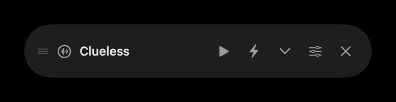
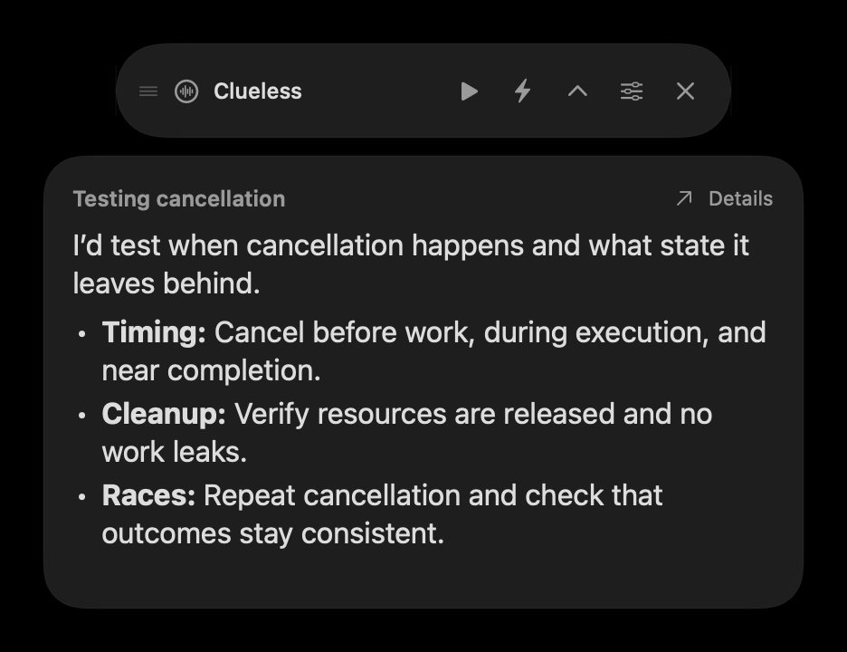
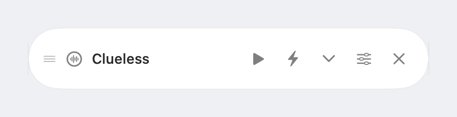
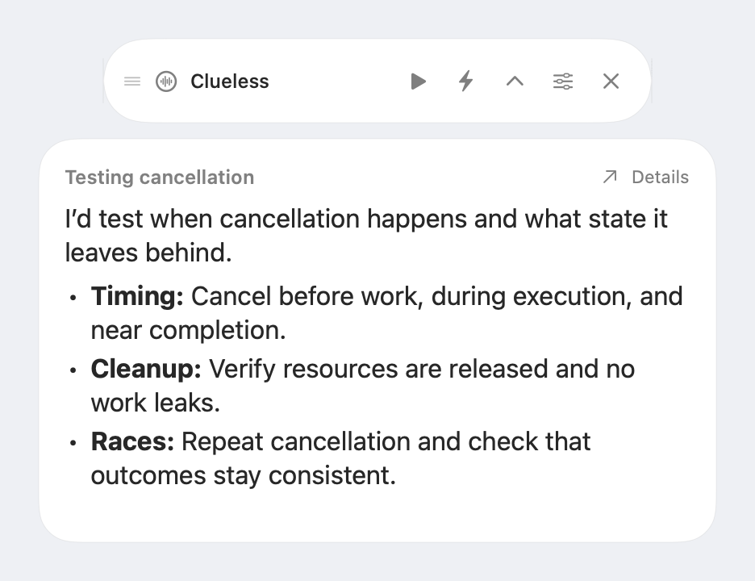
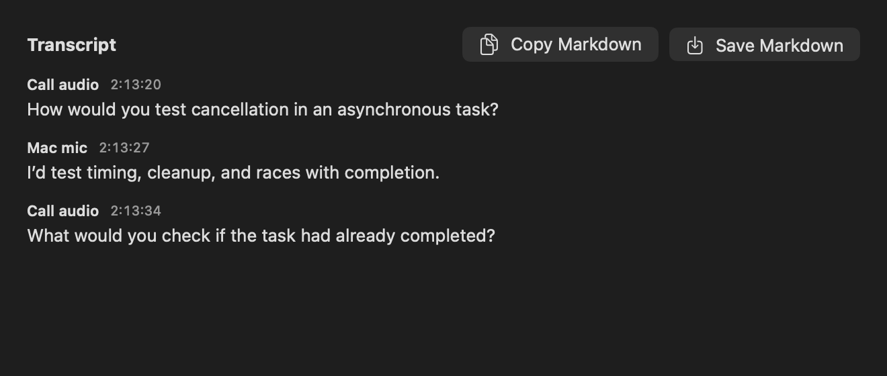
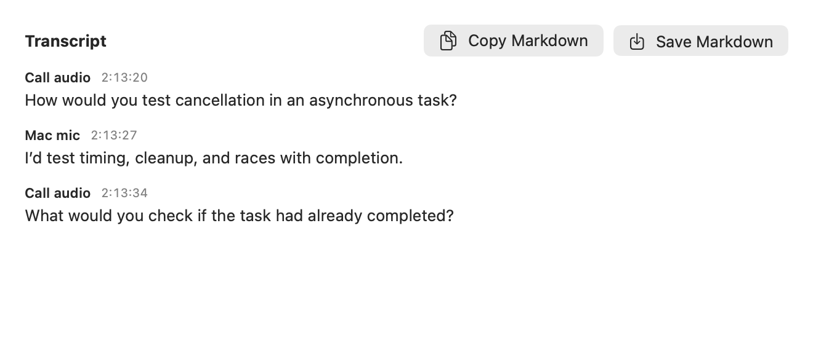

<div align="center">
  
  <h1>Clueless</h1>
  <p>A native macOS interview practice assistant and meeting notetaker.</p>
  <a href="https://github.com/Kian-hdr/clueless/releases/download/v0.3.0/Clueless-0.3.0-arm64.dmg"></a>
  <p><strong>Apple Silicon · macOS 14.2 or later</strong></p>
  <a href="LICENSE"></a>
  
</div>

Clueless transcribes your Mac mic and call audio separately, then streams a short opening you can read at a glance. Use it for interview practice, or switch to notetaker mode when you just want a transcript. English and German are supported.

## Screenshots

### Dark mode





### Light mode





<details>
<summary>See the transcript in both appearances</summary>

**Dark mode**



**Light mode**



</details>

## Install from the DMG

Download **Clueless-0.3.0-arm64.dmg** from [Clueless v0.3.0](https://github.com/Kian-hdr/clueless/releases/tag/v0.3.0), open it, and drag **Clueless** into **Applications**. Then follow the [first-run guide](docs/FIRST_RUN.md). This build is for Apple Silicon Macs running macOS 14.2 or later.

## Install with Homebrew

```bash
brew install --cask Kian-hdr/clueless/clueless
```

If Homebrew requires trust for third-party casks, run `brew tap Kian-hdr/clueless` and `brew trust --cask Kian-hdr/clueless/clueless`, then retry the install. The [tap](https://github.com/Kian-hdr/homebrew-clueless) installs the same notarized Apple Silicon build. After installing, follow the [first-run guide](docs/FIRST_RUN.md).

## Build from source

You'll need an **Apple Silicon Mac**, **macOS 14.2 or newer**, and **Xcode 27 or newer** to build the Icon Composer asset. The DMG does not require Xcode.

| Service | What you need | Where to configure it |
| --- | --- | --- |
| [ElevenLabs Scribe Realtime](https://elevenlabs.io/docs/api-reference/speech-to-text/v-1-speech-to-text-realtime) | An API key with speech-to-text access. Required for live transcription. | Clueless → **Settings** → **Setup** → **Save to Keychain**. |
| [OpenAI Codex CLI](https://developers.openai.com/codex/cli) | An installed, signed-in Codex CLI for answers. The current build looks for it at `/opt/homebrew/bin/codex`. | Sign in through the CLI. Clueless starts its own isolated app-server connection. |
| [OpenAI API](https://developers.openai.com/api/docs/models/gpt-6-luna) | Optional for the direct Fast opening. Requires a compatible local Keychain Drop runner and a single OpenAI credential profile that supplies `OPENAI_API_KEY`. | Configure the runner locally. Without it, Codex supplies the full answer. |
| Isolinear Memory | Optional. Requires the local Isolinear CLI and explicitly selected notes. | Select your Vault and notes in **Setup**. General answers work without a personal profile. |

```bash
git clone https://github.com/Kian-hdr/clueless.git
cd clueless
swift test
./script/build_and_run.sh
```

Open **Settings** from the floating bubble, enter your ElevenLabs key, then choose **Start listening** and follow the macOS audio permission prompts. Try **Question → Try sample question** to test answers without starting audio capture.

Setting this up with a coding agent? Use the [copy-ready setup prompt](docs/SETUP_PROMPT.md). See [AGENTS.md](AGENTS.md) for the architecture and development workflow.

## Use Clueless

- **Answer now** asks for an answer to the latest call question or a pasted prompt. GPT-6 Luna streams the opening and provides follow-up detail or code.
- **Collapse** leaves the floating controls visible. **Close** hides them. Reopen from the menu bar.
- **Transcript** shows finalized text with timestamps and source labels. Copy it as Markdown, or save a local transcript explicitly.
- **Collect meeting notes** is opt-in. Pause and save after the meeting. You can also opt into automatic notetaking on app launch, which saves finalized text on pause or normal quit.
- **Import captions** accepts SRT or WebVTT files for local note workflows.

The local MCP can control listening, report timing, and read current or saved Markdown transcripts. With Codex CLI installed, register it from the checkout:

```bash
codex mcp add clueless -- /usr/bin/python3 "$PWD/script/clueless_mcp.py"
```

## Privacy and current limits

While listening, Clueless sends separate mic and system audio streams to ElevenLabs. System capture can include audio from other apps. Answer requests send the question, bounded conversation, and any selected context to the configured OpenAI path. Provider terms, usage, and retention apply. Automatic capture and saving are opt-in. Clueless does not save raw audio locally.

Source labels describe the audio channel. Speakers and room echo can bleed across channels. Use a selected application window when sharing and verify the recipient’s view. Full-desktop invisibility, the two-second live latency target, and sustained live-call reliability are not established.

Original source and artwork are available under the [MIT License](LICENSE). Provider services and the Apple tools remain subject to their respective terms.
